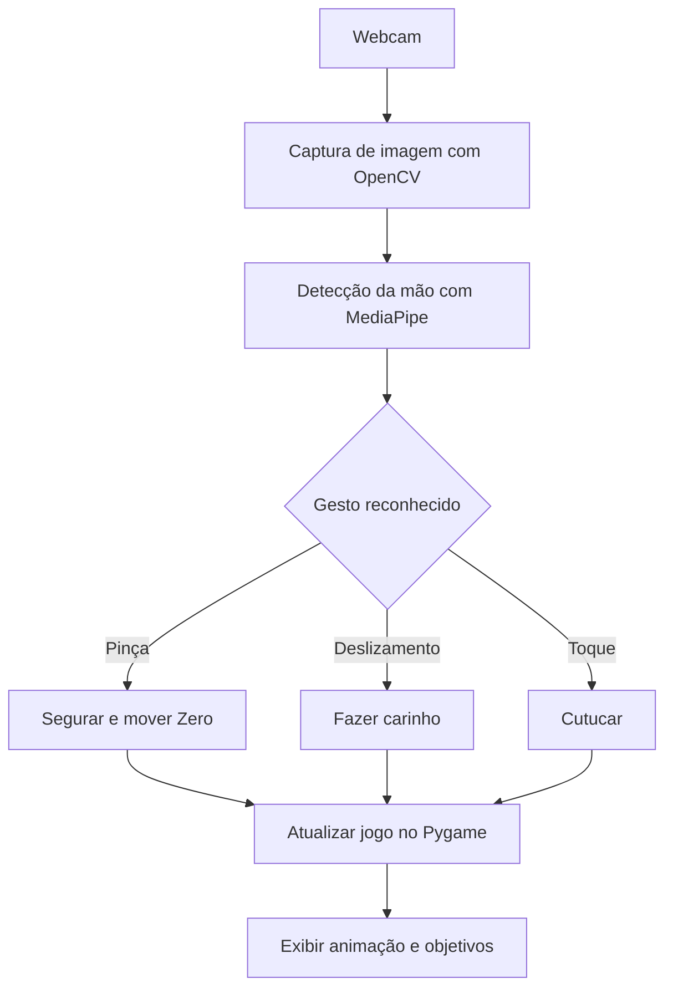

# ZERO — Ghost Companion 👻

> **Um jogo 2D interativo, controlado com gestos da mão, inspirado no Zero, o cachorro fantasma de *O Estranho Mundo de Jack*.**

**Disciplina:** Cognitive Computing / Computer Vision  
**Atividade:** CP3  
**Status:** 🟡 Proposta e planejamento — implementação ainda não iniciada

## 📖 Sobre o projeto

**ZERO — Ghost Companion** é a proposta de um jogo em que a webcam substitui os controles tradicionais. O jogador interage com Zero, um cachorro fantasma que flutua pelo cenário, utilizando movimentos da mão reconhecidos por visão computacional.

A ideia combina as interações de um companheiro virtual com um objetivo simples de jogo: **ajudar o Zero a coletar pequenas luzes espalhadas pelo ambiente**. O personagem reage às ações do jogador com movimentos e expressões, criando uma experiência lúdica e sem contato físico com a tela.

O visual proposto é inspirado na atmosfera gótica, artesanal e de stop-motion de *O Estranho Mundo de Jack*.

## 🎯 Objetivo

Criar um protótipo de jogo 2D que utilize **MediaPipe obrigatoriamente** para reconhecer gestos da mão em tempo real e transformá-los em interações com um personagem na tela, sem depender de mouse ou teclado durante a partida.

## 🎮 Como o jogo vai funcionar

1. O jogador inicia o jogo e autoriza o acesso à webcam.
2. O **OpenCV** captura os quadros da câmera.
3. O **MediaPipe** localiza os pontos de referência da mão.
4. O jogo interpreta os movimentos como gestos, como pinça, toque e deslizamento.
5. Zero responde à interação por meio de animações e movimentação na tela.
6. O jogador conduz Zero pelo cenário para coletar as luzes e completar a fase.

### Gestos e interações planejadas

| Gesto detectado | Ação no jogo | Resposta esperada |
| --- | --- | --- |
| 🤏 Aproximar polegar e indicador (pinça) sobre Zero | Segurar e arrastar | Zero acompanha a posição da mão, flutuando |
| ☝️ Deslizar o indicador sobre a cabeça | Fazer carinho | Zero demonstra felicidade e abana o rabo |
| ☝️ Aproximar o indicador e fazer um toque breve | Cutucar | Zero se assusta ou faz uma animação rápida |
| ✋ Abrir a mão perto do personagem | Chamar a atenção | Zero olha ou se aproxima da mão *(funcionalidade extra)* |
| 🤏 Levar Zero até uma luz | Coletar objetivo | A luz desaparece e a pontuação aumenta |

> As ações e os gestos acima representam o **escopo planejado** e poderão ser ajustados após os testes de reconhecimento.

## 🛠️ Tecnologias previstas

| Tecnologia | Utilização |
| --- | --- |
| **Python** | Lógica e organização do projeto |
| **MediaPipe** | Detecção e rastreamento dos pontos da mão |
| **OpenCV** | Captura de vídeo pela webcam |
| **Pygame** | Cenário, sprites, animações, colisões e interface 2D |
| **Git / GitHub** | Versionamento, documentação e entrega |

## 🔁 Fluxo do sistema



## 📁 Estrutura inicial do repositório

```text
zero-ghost-companion/
├── README.md              # Apresentação do projeto
├── .gitignore             # Arquivos que o Git deve ignorar
├── docs/
│   └── PLANEJAMENTO.md    # Escopo e etapas do desenvolvimento
├── assets/
│   └── .gitkeep           # Pasta reservada a artes, sprites e áudio
└── src/
    └── .gitkeep           # Pasta reservada ao código futuro
```

**Observação:** as pastas `src/` e `assets/` estão vazias neste momento porque esta etapa é **apenas a criação da proposta no GitHub**.

## 🗺️ Etapas de desenvolvimento

- [x] Definir o conceito e as mecânicas do jogo.
- [x] Criar a documentação inicial no GitHub.
- [ ] Implementar a captura de webcam com OpenCV.
- [ ] Integrar o rastreamento de mãos com MediaPipe.
- [ ] Detectar a pinça e permitir movimentar Zero.
- [ ] Criar as interações de carinho e cutucão.
- [ ] Implementar cenário, sprites e animações.
- [ ] Adicionar objetivo, pontuação e condições de vitória.
- [ ] Testar movimentos e melhorar a estabilidade dos gestos.
- [ ] Registrar uma demonstração do jogo funcionando.

## 💻 Execução

O jogo **ainda não está implementado**. Os comandos de instalação e execução serão adicionados após a primeira versão funcional.

## 👥 Integrantes

- **Nome(s):** preencher
- **Turma:** preencher

## ⚖️ Créditos e direitos autorais

Projeto acadêmico de fã, sem fins comerciais e **sem vínculo ou endosso da Disney**. O personagem Zero e *O Estranho Mundo de Jack* pertencem a seus respectivos titulares de direitos. O repositório não inclui imagens oficiais, músicas ou outros arquivos protegidos de terceiros.
